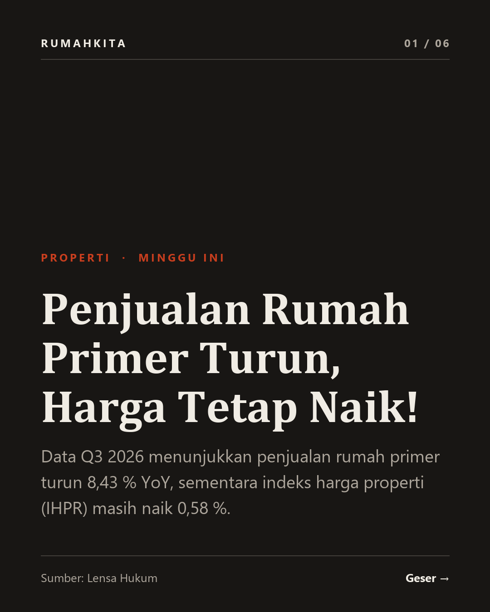
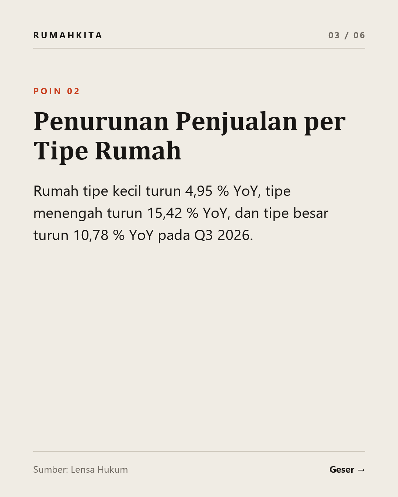

# Weekly IG Generator

Program Python yang mengubah berita properti Indonesia menjadi **carousel Instagram (6 slide isi + 1 slide kuis polling)** secara otomatis: dari mencari berita, merangkumnya dengan AI, sampai menghasilkan gambar PNG siap unggah, lengkap dengan caption, hashtag, dan referensi sumber berita.

## Cara kerja

```
ambil_berita.py → isi_artikel.py → generator.py → render.py
 cari berita       ambil isi         buat konten     buat gambar
 (Google News)     artikel           dengan AI       slide_1..7.png
                                     + validasi
                        ▲
        api.py (FastAPI) membungkus seluruh alur → dipanggil n8n tiap minggu
```

1. **`src/ambil_berita.py`**: mengambil berita 7 hari terakhir dari Google News RSS, menyaring yang relevan dengan properti Indonesia (kata kunci properti, membuang berita luar negeri dan topik kriminal), dan membuang judul ganda.
2. **`src/isi_artikel.py`**: membuka link asli artikel dan mengekstrak teksnya (dengan `trafilatura`). Artikel yang gagal diambil atau terlalu pendek dilewati.
3. **`src/generator.py`**: mengirim teks artikel ke model AI di Groq dengan instruksi dari `prompts/carousel_prompt.md`, lalu memvalidasi jawabannya. Jika tidak valid, AI diminta memperbaiki sekali. Artikel yang sudah dipakai dicatat di `output/terpakai.json` supaya tidak diulang di minggu berikutnya. Hasil disimpan ke `output/hasil.json`.
4. **`src/schemas.py`**: aturan validasi (Pydantic): tepat 6 slide, satu kuis polling (pertanyaan + 2-3 pilihan), batas panjang teks, 5-15 hashtag yang dirapikan otomatis.
5. **`src/render.py`**: membaca `hasil.json` dan menggambar tiap slide menjadi PNG 1080x1350 (rasio 4:5) dengan Pillow: 6 slide isi dengan latar gradasi biru, ditambah slide ke-7 berisi kuis ("Menurutmu?") dengan pilihan A/B/C.
6. **`src/api.py`**: FastAPI yang menjalankan seluruh alur lewat satu endpoint, agar bisa dipicu otomatis.
7. **`n8n/weekly-ig-workflow.json`**: workflow n8n yang memanggil API setiap Senin 08:00.

## Menjaga akurasi konten

AI hanya boleh memakai fakta dari teks artikel (aturan ada di prompt). Selain itu jawaban AI selalu divalidasi oleh `schemas.py` sebelum dipakai, sehingga format yang melanggar aturan tidak sampai ke tahap gambar. Referensi sumber (judul, media, tanggal, URL) diisi oleh kode, bukan oleh AI, sehingga tidak bisa dikarang.

## Prompt AI

Prompt lengkap ada di [`prompts/carousel_prompt.md`](prompts/carousel_prompt.md) dan dikirim sebagai *system message* ke Groq. Ringkasannya:

- **Peran:** content writer akun Instagram berita properti Indonesia.
- **Aturan akurasi:** hanya memakai fakta dari teks artikel; dilarang menambah angka, nama, tanggal, atau klaim; angka dan nama dipertahankan persis.
- **Struktur 6 slide:** (1) hook, (2-5) satu poin utama per slide, (6) kesimpulan.
- **Gaya:** santai tapi profesional, judul slide maks. 70 karakter, isi maks. 260 karakter.
- **Kuis:** satu polling opini (bukan pertanyaan fakta) dengan 2-3 pilihan; pertanyaan maks. 120 karakter, tiap pilihan maks. 45 karakter. Caption diakhiri pertanyaan polling dan ajakan menjawab di komentar.
- **Format output:** JSON dengan `ringkasan`, `slides` (6 item), `kuis`, `caption`, dan `hashtags` (8-12).

Pesan *user* berisi `JUDUL` dan `TEKS ARTIKEL` hasil ekstraksi. Model dipanggil dengan `temperature=0.3` dan `response_format=json_object` agar keluaran stabil. Jawaban divalidasi Pydantic; bila gagal, pesan error dikirim kembali ke AI untuk diperbaiki satu kali.

## Instalasi

Butuh Python 3.10 atau lebih baru.

```bash
python -m venv venv
venv\Scripts\activate          # Windows
pip install -r requirements.txt
```

Salin `.env.example` menjadi `.env`, lalu isi API key Groq (gratis di https://console.groq.com):

```
GROQ_API_KEY=isi_api_key_groq_kamu
GROQ_MODEL=openai/gpt-oss-120b     # opsional, ini nilai bawaan
```

## Cara menjalankan

### A. Lewat skrip (manual)

Jalankan dari folder utama proyek:

```bash
python src/generator.py    # cari berita, buat konten, simpan output/hasil.json
python src/render.py       # buat output/slide_1.png ... slide_7.png (slide 7 = kuis)
```

Untuk mencoba bagian pengambil berita saja:

```bash
python src/ambil_berita.py
```

Untuk mengulang dengan artikel yang sama saat percobaan, hapus `output/terpakai.json`.

### B. Lewat API

```bash
python -m uvicorn api:app --app-dir src --port 8000
```

| Endpoint | Fungsi |
|---|---|
| `GET /health` | Cek server hidup |
| `POST /generate` | Jalankan alur lengkap (berita → AI → 7 PNG), kembalikan JSON hasil beserta `slides_url` |
| `GET /result` | Hasil generate terakhir |
| `GET /slides/{1-7}` | Unduh gambar slide (7 = kuis) |

Dokumentasi interaktif tersedia di http://127.0.0.1:8000/docs.

### C. Otomasi mingguan dengan n8n

1. Jalankan API seperti di atas, lalu jalankan n8n: `npx n8n` (buka http://localhost:5678).
2. Impor `n8n/weekly-ig-workflow.json` (menu ⋯ → Import from File).
3. Klik **Execute workflow** untuk mencoba, atau aktifkan workflow agar berjalan otomatis setiap Senin 08:00.

Workflow: `Trigger mingguan → POST /generate → rapikan output` (judul, sumber, ringkasan, caption + hashtag, URL tiap slide).

> Publikasi otomatis ke Instagram belum diimplementasikan. Gambar dan caption diunggah manual.

## Contoh hasil

Contoh keluaran lengkap ada di folder [`examples/`](examples/) (`hasil.json` + 6 PNG). `hasil.json` juga memuat **referensi sumber berita asli** (`sumber_artikel`: judul, media, tanggal, URL).

| Slide 1 (hook) | Slide 3 |
|---|---|
|  |  |

## Struktur folder

```
weekly-ig-generator/
├── src/
│   ├── ambil_berita.py
│   ├── isi_artikel.py
│   ├── generator.py
│   ├── schemas.py
│   ├── render.py
│   └── api.py
├── prompts/
│   └── carousel_prompt.md
├── n8n/
│   └── weekly-ig-workflow.json
├── examples/              # contoh hasil
├── output/                # hasil run (tidak masuk git)
├── requirements.txt
└── .env.example
```

## Keterbatasan saat ini

- Filter berita berbasis kata kunci pada judul, bukan pemahaman AI. Berita asing yang tidak menyebut nama negara masih bisa lolos, dan sebaliknya berita Indonesia yang menyebut negara asing bisa terbuang.
- Deteksi duplikat hanya menangkap judul yang hampir identik.
- Satu kali jalan menghasilkan satu carousel dari satu artikel.
- Percobaan ulang ke AI hanya sekali; kegagalan jaringan atau batas API belum ditangani khusus.
- Beberapa situs memblokir pengambilan isi artikel; artikel tersebut dilewati.
- Font diambil dari folder font sistem (Windows/Linux), tampilan bisa sedikit berbeda antar komputer.
- Carousel Instagram tidak mendukung polling bawaan (hanya Story), jadi kuis dijawab lewat kolom komentar.
- Belum ada publikasi otomatis ke Instagram.

## Rencana pengembangan

- Pemilihan artikel terbaik oleh AI, bukan hanya artikel terbaru.
- Foto latar properti dan desain khusus slide pembuka/penutup.
- Publikasi otomatis via Instagram Graph API.
- Dashboard untuk meninjau hasil sebelum diunggah.

## Teknologi

Python, FastAPI, feedparser, trafilatura, Groq API, Pydantic, Pillow, n8n.
